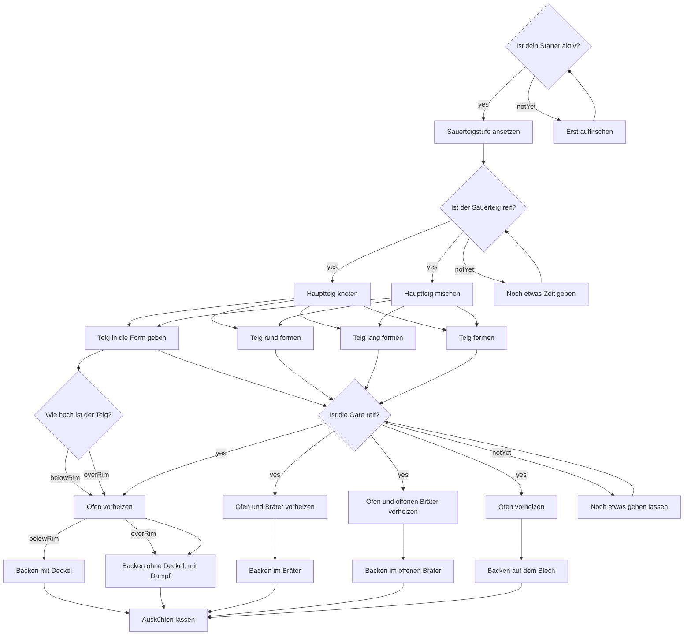

# Ablauf eines Brotback-Durchgangs

Das Diagramm entsteht aus der Ablaufdefinition im Package (`BakeProcess.mermaid()`): jeder Schritt mit dem Titel seines Textes, jede Antwort einer Entscheidung und jede Variante der Utensilien. Rauten sind Entscheidungen, Rechtecke Schritte. `BakeProcessTests` prüft, dass diese Datei zur Definition passt; nach einer Änderung am Ablauf wird der Block hier neu erzeugt.

