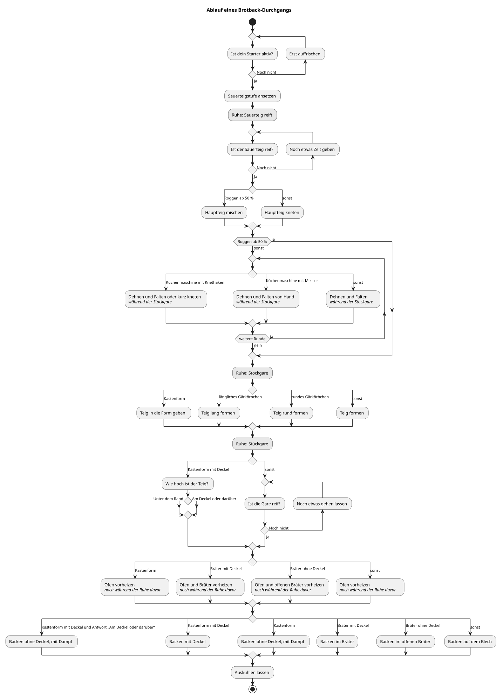
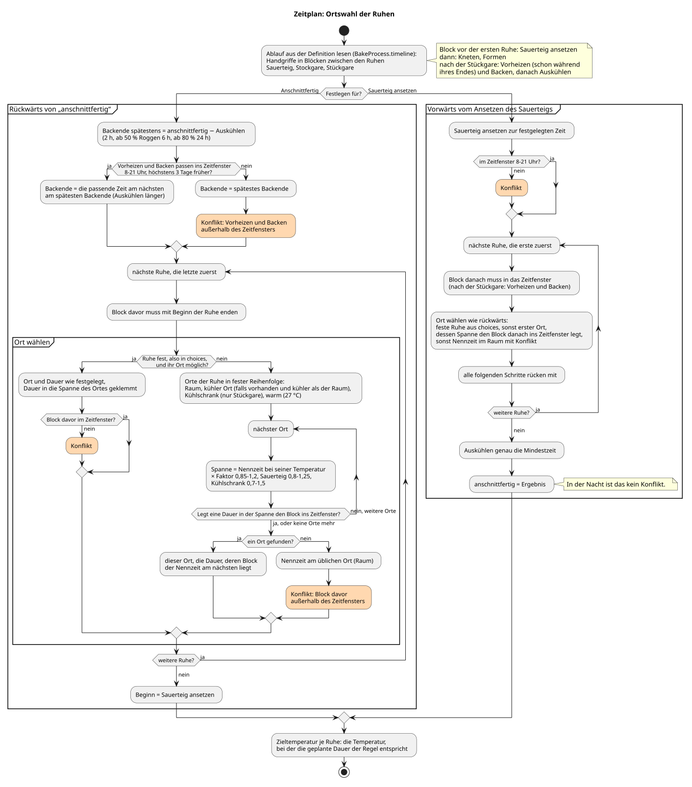

# Ablauf eines Brotback-Durchgangs

Das Diagramm entsteht aus der Ablaufdefinition im Package
(`BakeProcess.nodes`, Generator `BakeProcess.plantUML()`): ein
PlantUML-Aktivitätsdiagramm mit jedem Schritt unter dem Titel seines Textes,
jeder Ruhe (grau), jeder Antwort einer Entscheidung und jeder Verzweigung nach
Utensilien, Roggenanteil und früheren Antworten. Jeder Zweig trägt die
Bedingung, die der Durchgang auswertet (`BakeProcess.Condition`); „sonst“ ist
der Zweig, wenn keine Regel davor zutrifft. Eine Entscheidung, die mit „Noch
nicht“ beantwortet werden kann, läuft über den Text für die Zwischenzeit
zurück. Dehnen und Falten ist eine Wiederholung („weitere Runde“) während der
Stockgare, so oft, wie der Zeitplan Runden plant; ab 50 % Roggen entfällt der
Schritt ganz.

- Quelle: [`ablauf.puml`](ablauf.puml), erzeugt, nicht von Hand bearbeiten.
- Bild: [`ablauf.svg`](ablauf.svg), mit `tools/diagrams.sh` gezeichnet.

`BakeProcessTests` prüft, dass `ablauf.puml` zur Definition passt, dass jeder
Knoten erreichbar ist und jede Bedingung im Diagramm vorkommt. Nach einer
Änderung am Ablauf schreibt `tools/diagrams.sh` die Quelle neu und zeichnet
die SVG.

Wie der Zeitplan für die Ruhen einen Ort wählt, zeigt das von Hand gepflegte
Diagramm [`ortswahl.puml`](ortswahl.puml) ([`ortswahl.svg`](ortswahl.svg)).

